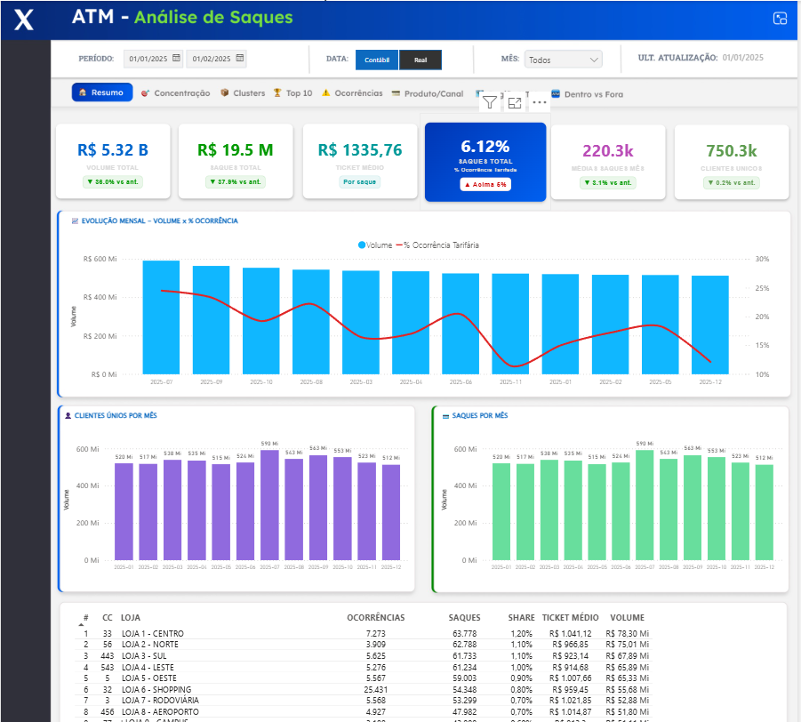

# 📊 Portfólio Power BI - Dashboards

Dashboards desenvolvidos em Power BI, com foco em design de interface, navegação e indicadores de negócio. **Todos os dados são fictícios.**

## 📂 Projetos

### 1. 🎯 Painel de Metas

Painel para acompanhamento mensal de metas de uma operação de atendimento, organizado por tema (Atendimento, Ouvidoria, Resolução, Retenção e Migração de Canal).

**Destaques**
- Três visões navegáveis: **Cartões** (resumo do mês), **Timeline** (evolução) e **Tabelas** (realizado × meta mês a mês)
- Cada indicador mostra o realizado, a meta, o % atingido, o desvio e o status (atingiu / não atingiu)
- Peso de cada meta no resultado consolidado
- Glossário integrado explicando cada indicador
- Indicadores em que "menor é melhor" (ex.: recontato, quantidade de reclamações) tratados corretamente no cálculo do atingimento

  

  

---

### 2. 🏧 ATM - Análise de Saques (protótipo)

Protótipo de dashboard para análise de saques em caixas eletrônicos, desenhado primeiro no Figma e depois construído no Power BI.

**Destaques**
- KPIs de volume, quantidade de saques, ticket médio, clientes únicos e % de ocorrência tarifária, com comparação ao período anterior
- Evolução mensal de volume × % de ocorrência
- Ranking de pontos por volume, com share e ticket médio
- Abas de concentração, clusters, top 10, ocorrências, produto/canal e dentro × fora da rede

  

## 🛠️ Ferramentas

Power BI · DAX · Figma

## 👤 Autor

[Laércio Moreira](https://www.linkedin.com/in/laerciomoreira96)
